<!-- ═══════════ HEADER ═══════════ -->
<p align="center">
  
</p>

<p align="center">
  <a href="https://github.com/mirbek10">
    
  </a>
</p>

<p align="center">
  
  
  
</p>

<br/>

<!-- ═══════════ ABOUT ═══════════ -->
<h2 align="center">◆ About</h2>

<table align="center">
<tr>
<td width="60%" valign="top">

```yaml
name:      Мирбек Атанбеков
role:      Front-End Developer
location:  Bishkek, Kyrgyzstan 🇰🇬
frontend:  [ React, Next.js, TypeScript, Tailwind ]
backend:   [ Go, REST API, PostgreSQL — base ]
email:     mirbekbook@gmail.com
phone:     +996 505 577 656
motto:     "Simplicity is the ultimate sophistication."
```

</td>
<td width="40%" align="center" valign="middle">
  
</td>
</tr>
</table>

<br/>

<!-- ═══════════ STACK ═══════════ -->
<h2 align="center">◆ Tech Stack</h2>

<p align="center"><b>Front-End</b></p>
<p align="center">
  
</p>

<p align="center"><b>Back-End · base</b></p>
<p align="center">
  
</p>

<p align="center"><b>Tools</b></p>
<p align="center">
  
</p>

<br/>

<!-- ═══════════ STATS ═══════════ -->
<h2 align="center">◆ GitHub Analytics</h2>

<p align="center">
  
  
</p>

<p align="center">
  
</p>

<br/>

<!-- ═══════════ FEATURED ═══════════ -->
<h2 align="center">◆ Featured Projects</h2>

<p align="center">
  <!-- Замени easy-finance / Portfolio на названия своих репозиториев -->
  <a href="https://github.com/mirbek10/easy-finance">
    
  </a>
  <a href="https://github.com/mirbek10/Portfolio">
    
  </a>
</p>

<br/>

<!-- ═══════════ SNAKE ═══════════ -->
<p align="center">
  <picture>
    <source media="(prefers-color-scheme: dark)" srcset="https://raw.githubusercontent.com/mirbek10/mirbek10/output/snake-dark.svg" />
    <source media="(prefers-color-scheme: light)" srcset="https://raw.githubusercontent.com/mirbek10/mirbek10/output/snake-light.svg" />
    
  </picture>
</p>

<br/>

<!-- ═══════════ CONTACT ═══════════ -->
<h2 align="center">◆ Contact</h2>

<p align="center">
  <a href="mailto:mirbekbook@gmail.com"></a>
  <br/>
  <a href="https://wa.me/996505577656"></a>
  <a href="tel:+996505577656"></a>
</p>

<!-- ═══════════ FOOTER ═══════════ -->
<p align="center">
  
</p>
